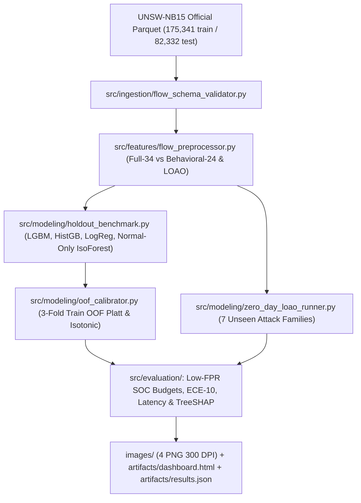
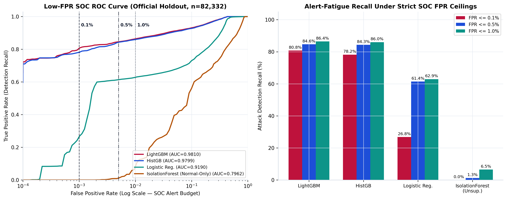
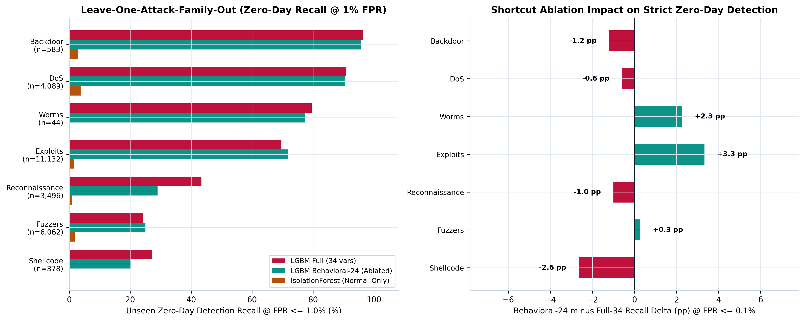
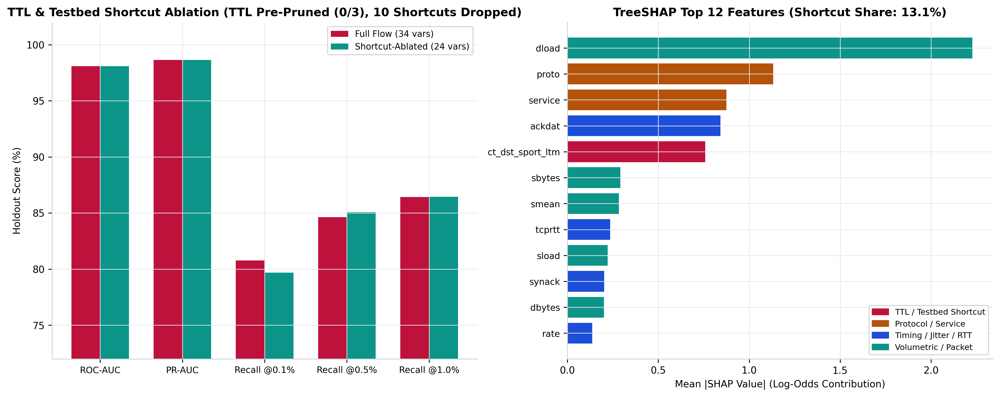
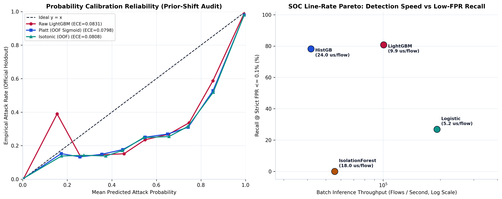

<div align="center">

# NIDSZ — Network Intrusion Detection & Zero-Day Generalization
### Étude de Cybersécurité Réseau sur 257 673 Flux (UNSW-NB15), Ablation des Raccourcis Lab, Points Opérationnels SOC Anti-Fatigue & Généralisation Zero-Day (LOAO)

<br/>


-BE123C?style=flat-square)


<br/>

**"From Data to Systems"**  
Monographie de détection d'intrusions réseau analysant **257 673 flux officiels UNSW-NB15** (`175 341` entraînement / `82 332` holdout officiel, zéro mélange) répartis entre trafic `Normal` et **9 familles d'attaques**, combinant audit de raccourcis topologiques (*TTL* & table de connexions), évaluation SOC anti-fatigue d'alertes sous plafonds stricts (`FPR <= 0.1%`, `0.5%`, `1.0%`), protocole **Zero-Day Leave-One-Attack-Family-Out (LOAO)** sur 7 familles inédites, calibration probabiliste hors-pli (*Platt / Isotonic*) et profilage de latence d'inférence ligne-vitesse.

</div>

<br/>

<table align="center">
<tr>
<td align="center"><h2>257,673</h2><sub>flux réseau UNSW-NB15 (officiel)</sub></td>
<td align="center"><h2>0.9810</h2><sub>ROC-AUC holdout (LightGBM Platt)</sub></td>
<td align="center"><h2>80.77%</h2><sub>Recall @ FPR &le; 0.1% (anti-fatigue)</sub></td>
<td align="center"><h2>86.45%</h2><sub>Recall @ FPR &le; 1.0% (Behavioral-24)</sub></td>
<td align="center"><h2>100,688</h2><sub>flux/sec (9.93 &mu;s/flux, LightGBM)</sub></td>
<td align="center"><h2>+3.33 pp</h2><sub>gain Zero-Day Exploits sans shortcuts</sub></td>
</tr>
</table>

---

## Table des Matières

1. [Problématique SOC & Enjeux de Généralisation Zero-Day](#problématique-soc--enjeux-de-généralisation-zero-day)
2. [Audit d'Intégrité, Partition Officielle & Raccourcis de Laboratoire (UNSW-NB15)](#audit-dintégrité-partition-officielle--raccourcis-de-laboratoire-unsw-nb15)
3. [Architecture du Système](#architecture-du-système)
4. [Méthodologie : Ablation des Raccourcis, Budgets Low-FPR & Protocole LOAO](#méthodologie--ablation-des-raccourcis-budgets-low-fpr--protocole-loao)
5. [Résultats Empiriques : Holdout Officiel, Zero-Day LOAO & Latence](#résultats-empiriques--holdout-officiel-zero-day-loao--latence)
6. [Preuves Visuelles (300 DPI)](#preuves-visuelles-300-dpi)
7. [Dictionnaire des Variables & Hyperparamètres](#dictionnaire-des-variables--hyperparamètres)
8. [Dashboard Interactif & Guide de Reproduction](#dashboard-interactif--guide-de-reproduction)

---

## Problématique SOC & Enjeux de Généralisation Zero-Day

Les détecteurs d'intrusions réseau (*NIDS*) publiés dans la littérature souffrent de trois biais critiques qui les rendent inexploitables en Centre Opérationnel de Sécurité (*SOC*) :
1. **Fatigue d'alertes à haut FPR** : un modèle affichant `98%` de ROC-AUC mais évalué à `5%` de faux positifs génère `5 000` fausses alertes pour `100 000` flux bénins — saturant immédiatement les analystes L1. En production, seuls comptent **Recall @ FPR <= 0.1%** (`<= 100` fausses alertes / `100k` flux), **0.5%** et **1.0%**.
2. **Raccourcis topologiques du banc de test (*Lab Shortcuts*)** : les variables TTL (`sttl`, `dttl`, `ct_state_ttl`), les fenêtres/séquences TCP synthétiques (`swin`, `dwin`, `stcpb`, `dtcpb`) et les compteurs de table de session (`state`, `ct_dst_sport_ltm`, `ct_src_dport_ltm`) encodent la topologie du générateur IXIA PerfectStorm plutôt que le comportement réel des attaques.
3. **Illusion de généralisation Zero-Day** : un split classique évalue la mémorisation de familles déjà vues en entraînement. Seul un protocole **Leave-One-Attack-Family-Out (LOAO)** révèle les angles morts réels sur des menaces inédites (`Fuzzers`, `Shellcode`, `Exploits`, `Worms`).

---

## Audit d'Intégrité, Partition Officielle & Raccourcis de Laboratoire (UNSW-NB15)

Le module [`src/ingestion/flow_schema_validator.py`](./src/ingestion/flow_schema_validator.py) charge les deux fichiers Parquet officiels sans aucun mélange :
- **Volume officiel** : `175 341` flux d'entraînement (taux d'attaque `68.06%`) et `82 332` flux de holdout officiel (taux d'attaque `55.06%`), soit **`257 673` flux × `36` colonnes** (`34` variables prédictives, `0` valeur manquante, cohérence stricte `Normal <-> label == 0`).
- **Audit de raccourcis TTL & banc de test** :
  - Colonnes TTL (`sttl`, `dttl`, `ct_state_ttl`) : **`0/3` présentes** — cette édition Parquet 36 colonnes a déjà purgé la fuite TTL historique du CSV 45 colonnes.
  - Raccourcis d'état/en-tête TCP & table de connexions identifiés (`10` colonnes) : `state`, `swin`, `dwin`, `stcpb`, `dtcpb`, `ct_src_dport_ltm`, `ct_dst_sport_ltm`, `ct_flw_http_mthd`, `ct_ftp_cmd`, `is_sm_ips_ports`.
- **Audit de duplication & recouvrement inter-splits** : `78 519` doublons exacts en train (`92 098` vecteurs uniques), `32 361` en test (`48 231` vecteurs uniques) et **`20 851` flux de test (`25.33%`)** partageant un vecteur de 34 attributs identique avec le jeu d'entraînement (`1 487` signatures distinctes) — un artefact structurel documenté de la partition officielle UNSW-NB15.
- **Prétraitement anti-fuite** ([`src/features/flow_preprocessor.py`](./src/features/flow_preprocessor.py)) : vocabulaires catégoriels ajustés strictement sur le train (toute modalité inédite en test est projetée sur `__UNSEEN__`), normalisation `signed-log1p + StandardScaler` encapsulée dans le pipeline entraîné sur le train seul.

---

## Architecture du Système



---

## Méthodologie : Ablation des Raccourcis, Budgets Low-FPR & Protocole LOAO

1. **Ablation comportementale (`full_flow` 34 vars vs `shortcut_ablated` 24 vars)** : suppression systématique des colonnes TTL (si présentes) et des 10 artefacts de banc de test/table de connexions pour mesurer la détection purement volumétrique, protocolaire et temporelle (`dload`, `ackdat`, `sbytes`, `smean`, `tcprtt`).
2. **Calibration hors-pli sans fuite (`oof_calibrator.py`)** : ajustement des calibrateurs *Platt Scaling* et *Isotonic Regression* sur prédictions OOF 3-plis strictement internes au train, puis évaluation sur le holdout officiel. Le **prior shift** natif (`68.06%` d'attaques en train vs `55.06%` en test) explique un `ECE-10 = 0.0798` honnête ; surtout, **Platt surpasse Isotonic** dans la queue ultra-faible FPR (`80.77%` vs `78.80%` à `FPR <= 0.1%`) car sa transformation strictement monotone évite les paliers ex-aequo de la régression isotonique.
3. **Zero-Day LOAO (`zero_day_loao_runner.py`)** : pour chacune des 7 familles majeures (`Backdoor`, `DoS`, `Worms`, `Exploits`, `Reconnaissance`, `Fuzzers`, `Shellcode`), le classifieur est entraîné **exclusivement sur `Normal` + les autres familles** (`0` flux de la famille cible en train), puis évalué face aux `37 000` flux `Normal` du holdout officiel. En parallèle, `IsolationForest` est entraîné **uniquement sur `Normal`** (zéro étiquette d'attaque).

---

## Résultats Empiriques : Holdout Officiel, Zero-Day LOAO & Latence

### 1. Benchmark Holdout Officiel (`82 332` flux) & Points Opérationnels SOC

| Mode / Modèle (Calibration) | ROC-AUC | PR-AUC | F1 Opt. | Brier | ECE-10 | Recall @0.1% | Recall @0.5% | Recall @1.0% | Débit (flux/s) | Latence (&mu;s/flux) |
|---|---:|---:|---:|---:|---:|---:|---:|---:|---:|---:|
| **Full-34 — LightGBM (Platt OOF)** | **`0.9810`** | **`0.9864`** | **`0.9347`** | `0.0766` | **`0.0798`** | **`80.77%`** | `84.64%` | `86.43%` | `100,688` | `9.93` |
| **Full-34 — LightGBM (Isotonic OOF)** | `0.9809` | `0.9857` | `0.9344` | `0.0773` | `0.0808` | `78.80%` | `84.45%` | `86.25%` | `100,688` | `9.93` |
| **Full-34 — HistGB (Platt OOF)** | `0.9799` | `0.9856` | `0.9315` | `0.0791` | `0.0819` | `78.20%` | `84.33%` | `85.98%` | `41,708` | `23.98` |
| **Full-34 — Logistic Regression (Platt)** | `0.9190` | `0.9379` | `0.8426` | `0.1374` | `0.1080` | `26.84%` | `61.41%` | `62.91%` | **`192,001`** | **`5.21`** |
| **Full-34 — IsolationForest (Normal-Only)** | `0.7962` | `0.8196` | `0.7537` | `0.1990` | `0.1159` | `0.00%` | `1.26%` | `6.54%` | `55,592` | `17.99` |
| **Behavioral-24 — LightGBM (Platt OOF)** | `0.9809` | `0.9863` | `0.9327` | **`0.0764`** | `0.0809` | `79.68%` | **`85.08%`** | **`86.45%`** | `142,948` | `7.00` |
| **Behavioral-24 — HistGB (Platt OOF)** | `0.9801` | `0.9857` | `0.9298` | `0.0780` | `0.0819` | `79.04%` | `84.08%` | `85.65%` | `67,908` | `14.73` |
| **Behavioral-24 — Logistic Reg. (Platt)** | `0.9122` | `0.9325` | `0.8404` | `0.1411` | `0.1132` | `18.32%` | `61.01%` | `62.61%` | `386,897` | `2.58` |
| **Behavioral-24 — IsoForest (Normal-Only)** | `0.8006` | `0.7810` | `0.8013` | `0.2008` | `0.1244` | `0.11%` | `0.29%` | `1.14%` | `37,744` | `26.49` |

### 2. Généralisation Zero-Day : Leave-One-Attack-Family-Out (7 Familles Inédites)

| Famille Inédite (Zero-Day) | Flux Test | AUC Full-34 | AUC Behav-24 | AUC IsoForest | Full @0.1% | Behav-24 @0.1% | Full @1.0% | Behav-24 @1.0% | Iso @1.0% |
|---|---:|---:|---:|---:|---:|---:|---:|---:|---:|
| **Backdoor** | `583` | `0.9952` | **`0.9956`** | `0.8766` | `92.62%` | `91.42%` | `96.40%` | `95.88%` | `2.92%` |
| **DoS** | `4,089` | `0.9910` | `0.9902` | `0.8227` | `84.72%` | `84.13%` | `90.93%` | `90.49%` | `3.72%` |
| **Worms** | `44` | `0.9824` | `0.9822` | `0.6681` | `63.64%` | **`65.91%`** | `79.55%` | `77.27%` | `0.00%` |
| **Exploits** | `11,132` | `0.9708` | `0.9696` | `0.6947` | `44.01%` | **`47.34%`** | `69.66%` | **`71.78%`** | `1.60%` |
| **Reconnaissance** | `3,496` | `0.9358` | `0.9349` | `0.5571` | `20.97%` | `19.97%` | `43.36%` | `28.95%` | `0.94%` |
| **Fuzzers** | `6,062` | `0.8143` | **`0.8399`** | `0.5998` | `21.10%` | **`21.38%`** | `24.17%` | **`25.02%`** | `1.81%` |
| **Shellcode** | `378` | `0.9372` | `0.9078` | `0.5185` | `5.03%` | `2.38%` | `27.25%` | `20.37%` | `0.00%` |

**Enseignements clés cybersécurité :**
- **Ablation bénéfique sur les menaces complexes** : supprimer les 10 raccourcis de laboratoire (qui pèsent `13.11%` du SHAP global, dominés par `ct_dst_sport_ltm`) améliore la détection Zero-Day sur **`Exploits`** (`+3.33 pp` à `0.1%` FPR, `+2.12 pp` à `1.0%` FPR), **`Worms`** (`+2.27 pp` à `0.1%` FPR) et **`Fuzzers`** (`+2.56` points d'AUC), tout en accélérant l'inférence LightGBM de `9.93` à **`7.00 µs/flux`** (`142 948` flux/sec).
- **Angle mort Zero-Day documenté** : `Fuzzers` (`24–25%` @ 1% FPR) et `Shellcode` (`20–27%` @ 1% FPR) demeurent difficiles à isoler à très faible faux-positif sans signatures dédiées ou inspection applicative (*DPI/EDR*).

---

## Preuves Visuelles (300 DPI)

| Figure | Analyse |
|---|---|
|  | **Courbe ROC Log-FPR & Rappel Anti-Fatigue.** Performance sous plafonds SOC `0.1%`, `0.5%` et `1.0%` FPR (`80.77%` dès `0.1%` pour LightGBM vs `26.84%` pour Logistic Regression). |
|  | **Benchmark Zero-Day LOAO (7 Familles).** Généralisation forte sur `Backdoor`/`DoS`, gain de l'ablation sur `Exploits`/`Worms`/`Fuzzers`, et angle mort critique sur `Shellcode`/`Fuzzers`. |
|  | **Ablation des Raccourcis & TreeSHAP.** Audit TTL pré-purgé (`0/3`), suppression des 10 raccourcis (`13.11%` de part SHAP) et hiérarchie comportementale dominée par `dload`, `proto`, `service`, `ackdat`. |
|  | **Calibration OOF (Prior-Shift) & Pareto Latence.** Supériorité de Platt OOF (`ECE-10 = 0.0798`) et compromis débit/détection (`100k+` flux/s à `< 10 µs/flux` pour LightGBM). |

---

## Dictionnaire des Variables & Hyperparamètres

- **Variables comportementales clés (`Behavioral-24`)** : `dload`, `sload` (débit bits/s), `proto`, `service` (protocole/applicatif), `ackdat`, `synack`, `tcprtt`, `dur`, `rate`, `sinpkt`, `dinpkt`, `sjit`, `djit` (dynamique temporelle & gigue), `sbytes`, `dbytes`, `smean`, `dmean`, `spkts`, `dpkts`, `sloss`, `dloss`, `trans_depth`, `response_body_len`, `is_ftp_login`.
- **Raccourcis audités / ablatés** : TTL (`sttl`, `dttl`, `ct_state_ttl` — vérifiés absents), état/en-têtes TCP & table de connexions (`state`, `swin`, `dwin`, `stcpb`, `dtcpb`, `ct_src_dport_ltm`, `ct_dst_sport_ltm`, `ct_flw_http_mthd`, `ct_ftp_cmd`, `is_sm_ips_ports`).
- **Modèles & Hyperparamètres (`seed = 42`)** : `LightGBM` (`n_estimators=250`, `learning_rate=0.05`, `num_leaves=31`, `colsample_bytree=0.85`, `subsample=0.85`), `HistGradientBoosting` (`max_iter=200`, `max_leaf_nodes=31`, catégoriel natif), `LogisticRegression` (`signed-log1p + StandardScaler + OHE`, `C=1.0`), `IsolationForest` (`n_estimators=200`, `max_samples=512`, entraîné exclusivement sur `Normal`), calibration OOF 3-plis `Platt` & `Isotonic`.

---

## Dashboard Interactif & Guide de Reproduction

- **Dashboard Plotly HTML5 autonome** : [`artifacts/dashboard.html`](./artifacts/dashboard.html)
- **Sortie JSON complète** : [`artifacts/results.json`](./artifacts/results.json)
- **Notebook de référence exécuté** : [`notebooks/nidsz_zero_day_intrusion_study.ipynb`](./notebooks/nidsz_zero_day_intrusion_study.ipynb)
- **Suite de tests (`14/14` passés, incluant audit AST/DAG `ELMAS.md`, test zéro-fuite LOAO & monotonie low-FPR)** :

```powershell
.\run.ps1
C:\Users\elmas\AppData\Local\Programs\Python\Python310\python.exe -m pytest -v
```
